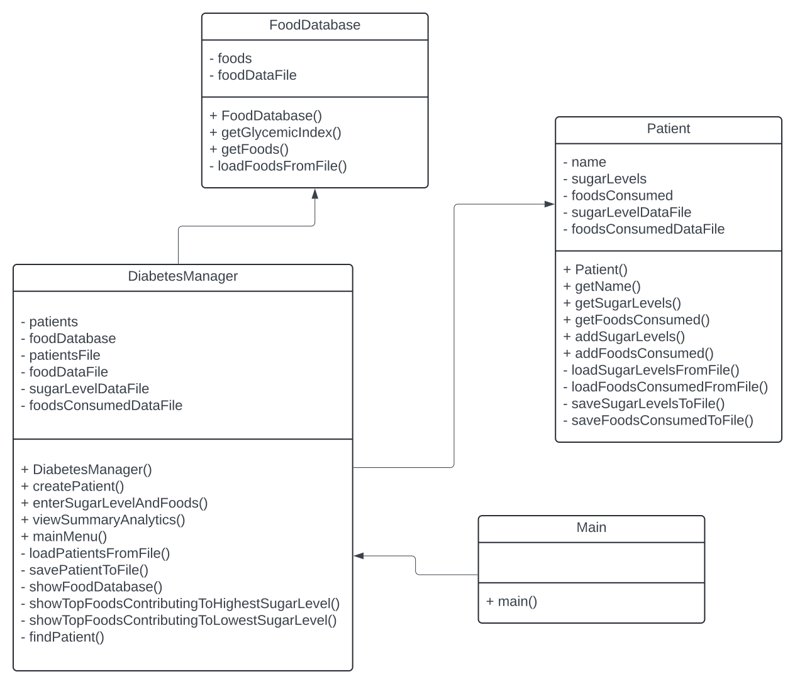
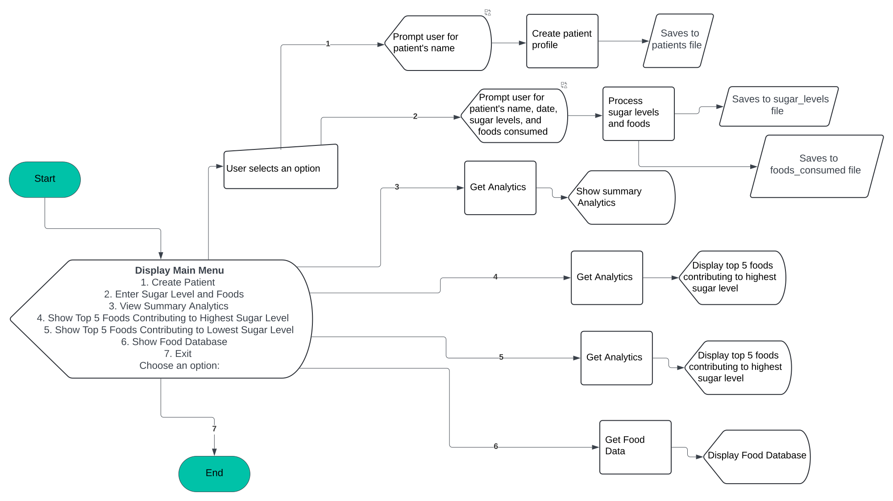

# Diabetes Management Tool

A Java command-line application for recording patient blood sugar readings and foods consumed, reviewing saved history, and exploring a small food database with glycemic-index values.

This project demonstrates object-oriented programming, Java collections, file I/O, CSV/text-file persistence, and a menu-driven console interface.

> **Educational project:** This application is not a medical device and does not provide medical diagnosis or treatment advice.

## Features

- Create and persist patient profiles.
- Record multiple blood sugar readings for a patient by date.
- Record foods consumed by a patient by date.
- Display summary history for stored patients.
- Load and display foods and glycemic-index values from a CSV file.
- Display the five most- and least-frequently recorded foods in the consumption history.
- Persist application data in simple text/CSV files.

## Technologies

- Java
- Object-Oriented Programming (OOP)
- Java Collections (`List`, `Map`, `HashMap`)
- File I/O (`BufferedReader`, `BufferedWriter`)
- Java Streams
- CSV and text-file persistence

## Project Structure

```text
diabetes-management-tool/
├── Main.java
├── DiabetesManager.java
├── Patient.java
├── FoodDatabase.java
├── data/
│   ├── foods.csv
│   ├── patients.txt
│   ├── sugar_levels.txt
│   └── foods_consumed.txt
├── docs/
│   ├── uml-diagram.svg
│   ├── flowchart.svg
│   └── project-plan-gantt-chart.pdf
├── .gitignore
└── README.md
```

## Design

### UML Diagram



### Application Flow



The application is organized around four Java classes:

- **`Main`** configures the data-file paths and starts the application.
- **`DiabetesManager`** coordinates patients, food data, menu actions, and summary views.
- **`Patient`** stores a patient's sugar-level and food-consumption history and persists updates.
- **`FoodDatabase`** loads food names and glycemic-index values from CSV data.

## Build and Run

### Prerequisites

Install a Java Development Kit (JDK). The project uses only the Java standard library and has no external dependencies.

### Compile

From the repository root:

```bash
javac Main.java DiabetesManager.java Patient.java FoodDatabase.java
```

### Run

```bash
java Main
```

The program displays the following menu:

```text
Main Menu
1. Create Patient
2. Enter Sugar Level and Foods
3. View Summary Analytics
4. Show Top 5 Foods Contributing to Highest Sugar Level
5. Show Top 5 Foods Contributing to Lowest Sugar Level
6. Show Food Database
7. Exit
```

## Sample Data

The `data/` directory contains sample records so the application can be explored immediately. Running the application may append new records to these files.

## What I Practiced

This project was built to practice Java application design from planning through implementation. It includes class design, a UML diagram, application flow design, local data persistence, implementation, testing/debugging, and project documentation.

The original project plan is included in [`docs/project-plan-gantt-chart.pdf`](docs/project-plan-gantt-chart.pdf).

## Possible Future Improvements

- Validate user input and handle malformed values more gracefully.
- Replace flat-file persistence with a relational database.
- Add unit tests.
- Add date-range filtering and richer analytics.
- Use glycemic-index values directly in dietary analysis.
- Add a graphical or web-based user interface.
